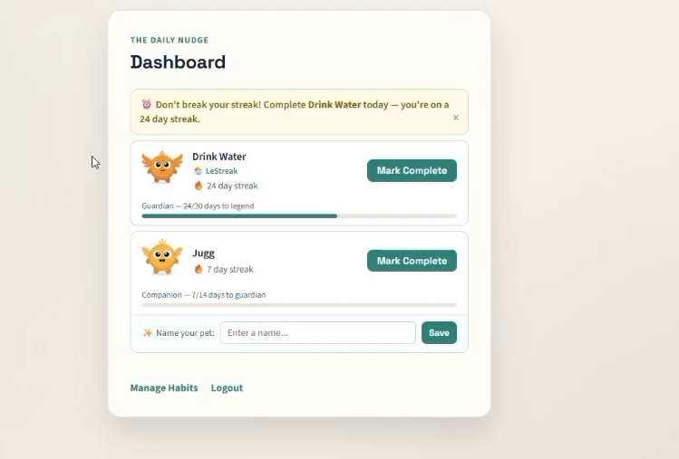
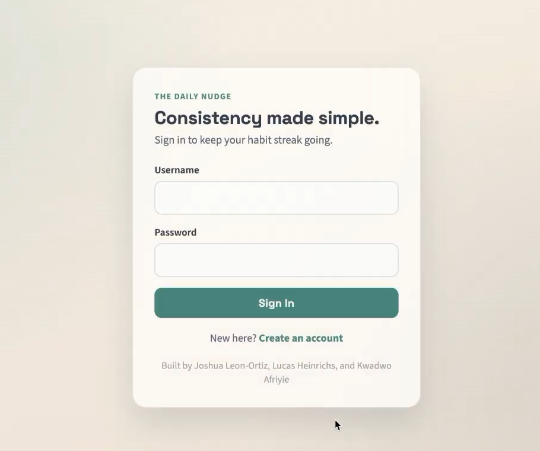
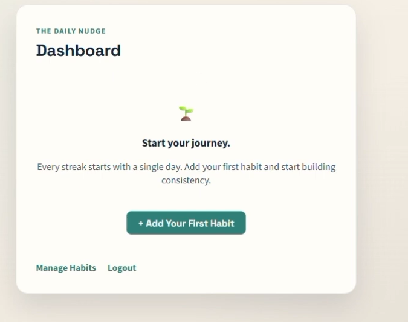
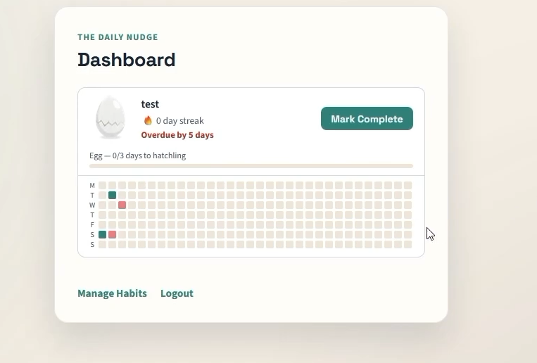

# The Daily Nudge

The Daily Nudge is a habit tracker that turns streaks into progress you can see: a pet that evolves with each habit, daily reminders, and a heatmap of completed and missed days.



| Sign in | First visit | Completion heatmap |
|---|---|---|
|  |  |  |

## Team & My Role

Built with Lucas Heinrichs and Joshua Leon for CptS 322 (Software Engineering I) at WSU. I led the backend: habit models, streak-calculation logic, the pet-evolution system, and the 24-test suite. Original repo: [vryo1/HabitTrackerWebApp](https://github.com/vryo1/HabitTrackerWebApp).

## Project Summary

A web app for creating habits that repeat on a set frequency, then managing and adjusting them to fit your goals. The UI keeps daily tracking front and center while making it easy to add new habits and edit existing ones.

## Installation

The Daily Nudge is a Django web app backed by PostgreSQL (originally hosted on Supabase).

### Prerequisites
- Git
- Python 3.12+ and pip
- A virtual environment tool (recommended: built-in venv)
- A PostgreSQL database (local or hosted, e.g. Supabase)

### Add-ons
- Django==6.0.2: Core web framework for routing, templates, models, and auth.
- psycopg2-binary==2.9.11: PostgreSQL adapter used by Django.
- django-environ==0.13.0: Reads environment variables for secure configuration.
- asgiref==3.11.1: ASGI support used by Django runtime.
- sqlparse==0.5.5: SQL parsing utility used by Django internals.
- tzdata==2025.3: Time zone database for consistent date/time handling.

### Installation Steps

1. **Clone the repository**
```bash
git clone https://github.com/kwadafriyie/daily-nudge.git
cd daily-nudge
```

2. **Create and activate a virtual environment**
```
python -m venv venv
.\venv\Scripts\Activate.ps1  (Windows)
source venv/bin/activate     (Mac/Linux)
```

3. **Install dependencies**
```
pip install -r requirements.txt
```

4. **Set up environment variables**
```
cp .env.example .env
```
Edit `.env` and fill in:
```
SECRET_KEY=your-own-long-random-string
DATABASE_URL=your-postgresql-connection-url
```

5. **Apply database migrations**
```
cd client
python manage.py migrate
```

6. **Run the development server**
```
python manage.py runserver
```
The app will be available at `http://127.0.0.1:8000/`

7. **Run unit tests**
```
python manage.py test Backend --keepdb
```
All 24 tests should pass. The `--keepdb` flag preserves the test database between runs to avoid cleanup conflicts with Supabase.

## Functionality

**Login Page** - Existing users can log in with their username and password.

**Create Account Page** - New users can register by choosing a username and password.

**Dashboard** - The main page after logging in. Each habit displays its name, current streak, a pet companion that evolves based on streak length, a progress bar toward the next pet stage, and a heatmap showing completed and missed days. Notification banners remind you to complete habits that are due today.

**Manage Habits Page** - Add new habits to the tracker. Press "Add Habit", fill out the habit details, and press "Add" to save it. The habit will then appear on the dashboard.

## Testing

Unit tests are located in `client/Backend/tests.py` and cover streak calculation, pet stage logic, due date calculation, habit CRUD operations, and pet naming. To run:
```
cd client
python manage.py test Backend --keepdb
```
Expected output: `Ran 24 tests ... OK`

## Known Problems

If you use Supabase's free tier, the database pauses after periods of inactivity. If the app appears unresponsive, resume the project from the Supabase dashboard.

## Additional Documentation

Sprint reports from the 3-sprint development cycle (each includes a demo video):

- [Sprint 1 Report](Sprint1Report.md)
- [Sprint 2 Report](Sprint2Report.md)
- [Sprint 3 Report](Sprint3Report.md)
